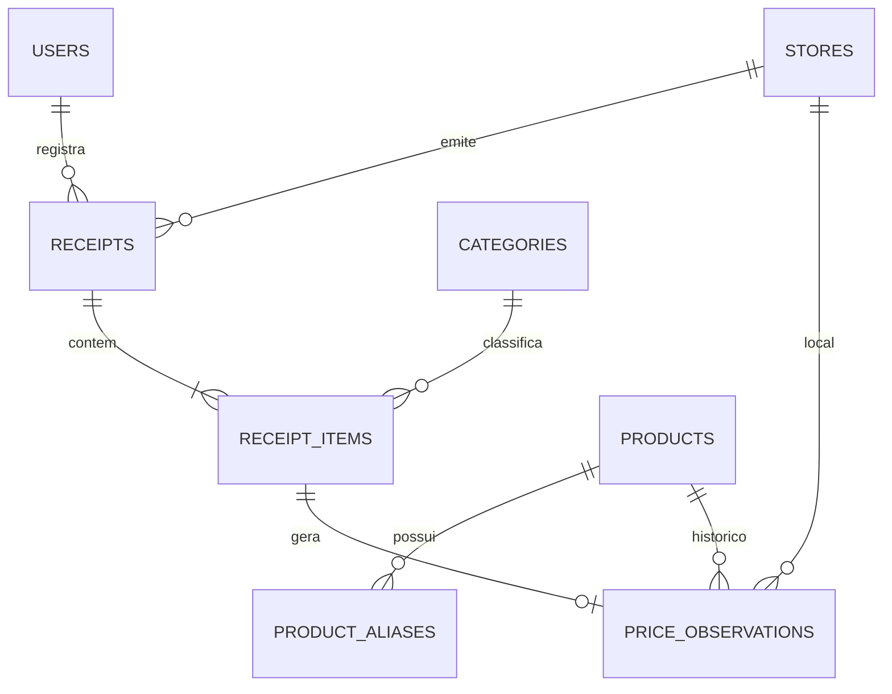

# Arquitetura do Baixômetro 🏗️

Este documento descreve as principais decisões arquiteturais, a organização do monorepo e o fluxo de dados do **Baixômetro**.

---

## 1. Visão Geral do Monorepo

```text
Baixometro/
├── apps/
│   ├── api/                  # Backend em Rust (Axum + SQLx + Tokio)
│   └── web/                  # Frontend SPA/PWA em React 19 + Vite + TypeScript
├── packages/
│   └── shared-types/         # Tipos TypeScript gerados automaticamente via ts-rs
├── infra/
│   ├── docker/               # Dockerfiles de desenvolvimento (.dev) e produção (.prod)
│   ├── migrations/           # Migrations SQL gerenciadas pelo SQLx
│   ├── docker-compose.yml       # Stack de desenvolvimento com hot-reload
│   └── docker-compose.prod.yml  # Stack de produção multi-stage (Nginx + Rust release)
└── .github/workflows/
    └── ci.yml                # Pipeline de Integração Contínua (Rust + Web)
```

---

## 2. Decisões Arquiteturais

### 🦀 Backend: Rust + Axum + SQLx
- **Performance e Segurança de Memória:** O backend foi construído em Rust sobre o runtime assíncrono `Tokio` e o framework web `Axum 0.8`, garantindo baixíssimo consumo de memória (binário final em container `debian:bookworm-slim`) e latência mínima nas agregações analíticas.
- **Precisão Monetária (`rust_decimal`):** Todos os valores financeiros e quantidades fracionadas utilizam `Decimal` (`NUMERIC(12,2)` / `NUMERIC(12,3)` no PostgreSQL) para evitar erros de arredondamento de ponto flutuante.
- **SQLx e Migrations Embutidas:** As migrations em `infra/migrations/` são embutidas no binário via `sqlx::migrate!` e aplicadas automaticamente na inicialização da API, facilitando o deploy em container único.
- **Arquitetura de Importação (`NfceImporter`):** A trait assíncrona `NfceImporter` (`apps/api/src/importers/mod.rs`) desacopla a rota `POST /receipts/import` da fonte de dados da NFC-e, permitindo alternar entre o `MockImporter` (para testes locais) e scrapers/APIs estaduais da SEFAZ sem alterar a regra de negócio de persistência.

### 🔗 Sincronização de Tipos Fim a Fim (`ts-rs`)
- Todas as structs de entrada e saída da API em `apps/api/src/models.rs` derivam `#[derive(TS)]` e `#[ts(export)]`.
- Ao rodar `cargo test`, o `ts-rs` exporta automaticamente as definições `.ts` em `packages/shared-types/`, garantindo que qualquer mudança no contrato do backend seja imediatamente validada pelo `tsc --noEmit` no frontend.

### ⚛️ Frontend: React 19 + Vite + Recharts (Mobile-First)
- **UX Mobile-First:** Desenhado prioritariamente para uso no celular (no corredor do supermercado ou ao chegar em casa com o cupom fiscal), com barra de navegação inferior fixa, leitura de QR Code via câmera (`html5-qrcode`) e gráficos responsivos (`Recharts`).
- **Dev Server Dual-Stack (HTTP + HTTPS na mesma porta `5173`):** Em desenvolvimento, um plugin customizado no `vite.config.ts` inspeciona o handshake TCP (`0x16` para TLS vs HTTP texto puro), permitindo acessar `http://localhost:5173` no PC e `https://<ip-local>:5173` no celular (exigido pelos navegadores móveis para liberar `navigator.mediaDevices.getUserMedia`).
- **Produção com Nginx:** Em produção (`Dockerfile.web.prod`), o bundle estático é servido pelo `nginx:alpine` na porta `80`, que também atua como proxy reverso para `/api/* -> http://api:3000/`.

---

## 3. Modelo de Inteligência de Preços



1. **Matching de Produto (`match_or_create_product`):**
   Quando uma nota é salva em `POST /receipts`, cada item passa por uma cascata de resolução dentro da mesma transação ACID:
   - **Vínculo Manual:** Se o usuário selecionou um `product_id` canônico no formulário, ele é utilizado diretamente.
   - **Busca por GTIN/EAN:** Caso o item possua código de barras (`gtin`), busca-se o produto correspondente em `products.gtin`.
   - **Busca por Alias (`product_aliases`):** Caso a descrição bruta da nota (`raw_description`, ex: `"CAFE PILAO TRAD 500G"`) já tenha sido vinculada anteriormente, o alias resolve para o `Product` canônico.
   - **Criação Canônica:** Se nenhuma regra acima encontrar correspondência, cria-se um novo `Product` canônico e registra-se seu alias.
2. **Normalização por Quilo/Litro (`compute_price_per_kg_l`):**
   - Itens vendidos em `KG` ou `L` usam diretamente seu `unit_price`.
   - Itens vendidos em unidades (`UN`, `PCT`, `CX`) têm sua descrição inspecionada para extrair gramaturas (`500g`, `5kg`, `1.5L`, `900ml`), calculando automaticamente o `unit_price_per_kg_l` gravado em `price_observations`.
3. **Detecção de Alertas (`GET /alerts`):**
   - Compara o preço unitário mais recente de cada produto com a média histórica dos últimos 30 dias (`price_observations`), sinalizando altas superiores a **10%**.

---

## 4. Economia de Contexto para Agentes de IA (Graphify)

O projeto utiliza o **Graphify** para manter um grafo estrutural de símbolos, rotas, componentes e tipos (`graphify-out/`, ignorado pelo Git). Conforme documentado em [`AGENTS.md`](AGENTS.md), agentes de IA devem consultar primeiro o grafo (`python -m graphify query "<termo>"`) antes de percorrer arquivos manualmente, reduzindo drasticamente o consumo de tokens e acelerando diagnósticos arquiteturais.

---

## 5. Estrutura Modular, Responsabilidades e Regra de Ouro (<= 400 Linhas)

Para facilitar a leitura por humanos, manter a manutenibilidade do código e economizar tokens de contexto nas sessões de IA, **nenhum arquivo no repositório (`apps/web/src` ou `apps/api/src`) pode exceder 400 linhas**.

### 🦀 Backend (Rust): Separação de Camadas
- **`apps/api/src/routes/`**: Camada de transporte HTTP pura. Recebe a requisição Axum, faz validação de payload e devolve a resposta HTTP adequada (JSON, status codes 200, 201, 409, 422).
- **`apps/api/src/repository/`**: Camada de persistência SQL e regras ACID.
  - `receipts.rs`: Transação de salvar notas com itens (`save_receipt_with_items`), detecção de duplicatas e substituição pós-revisão.
  - `products.rs`: Matching canônico (`match_or_create_product`), aliases (`ensure_product_alias`) e normalização R$/kg (`compute_price_per_kg_l`).
  - `stores.rs`: Resolução ou cadastro de estabelecimentos por CNPJ/Nome (`find_or_create_store`).
- **`apps/api/src/importers/`**: Módulos especializados de extração de dados fiscais.
  - `xml.rs`: Parser streaming de XML NFC-e Ceará/Nacional via `quick-xml`.
  - `html.rs`: Parser SEFAZ HTML com `scraper` e fallback resiliente.
  - `utils.rs`: Normalização de chaves de acesso de 44 dígitos e regexes.

### ⚛️ Frontend (React): Feature-Driven Design & Colocation
Os componentes e lógica de negócio são co-localizados dentro de pastas funcionais em `apps/web/src/features/<feature>/`:
- **`features/receipts/`**:
  - `components/`: `ReceiptItemRow.tsx`, `DuplicateReceiptAlertModal.tsx`.
  - `hooks/`: `useNewReceipt.ts` (máquina de estados do formulário, importação XML e QR Code).
  - `constants.ts` & `utils.ts`: XMLs de exemplo, datas e formatações.
- **`features/dashboard/`**:
  - `components/`: `DashboardKpiCards.tsx`, `ProductThermometerSection.tsx`, `PriceAlertsBanner.tsx`, `StoreRankingSection.tsx`, `SpendingChartsSection.tsx`, `CommunityPricesTab.tsx`, `CustomChartTooltip.tsx`.
  - `hooks/`: `useDashboardData.ts` (carregamento agregado, histórico e insights), `usePublicPrices.ts` (busca de crowdsourcing).
  - `types.ts`: Paletas de cores e contratos de métricas.
- **`features/products/components/`**: `EditProductModal.tsx`, `MergeProductModal.tsx`, `DeleteProductModal.tsx`.
- **`features/categories/components/`**: `CategoryFormModal.tsx`, `DeleteCategoryModal.tsx`.
- **`pages/`**: Páginas atuam exclusivamente como orquestradores de layout, mantendo-se sempre abaixo de 350 linhas.

### ⚡ Code Splitting e Otimização de Bundle
- **Dynamic Imports (`React.lazy` + `Suspense`):** Todas as páginas em `App.tsx` são carregadas sob demanda, descarregando dependências pesadas (`html5-qrcode` e `recharts`) do chunk inicial.
- **Rollup `manualChunks`:** Configurado no `vite.config.ts` para segregar vendors críticos:
  - `vendor-react` (`react`, `react-dom`, `react-router-dom`)
  - `vendor-recharts` (`recharts`)
  - `vendor-motion` (`framer-motion`)
  - `vendor-scanner` (`html5-qrcode`)
  - `vendor-icons` (`lucide-react`)
- O bundle inicial (`index.js`) caiu de 1.33MB para apenas ~260 kB (~81 kB gzipped).

### 📋 Formatação Padrão de Types TypeScript
Todos os tipos em `packages/shared-types/` e definições do frontend adotam organização vertical estrita:
```ts
export type Category = {
  id: string,
  name: string,
  color: string,
  icon: string,
};
```
- 1 campo por linha.
- 2 espaços de indentação.
- Vírgula obrigatória em todas as propriedades (inclusive na última).
- Sem comentários de cabeçalho do gerador (`ts-rs`).


